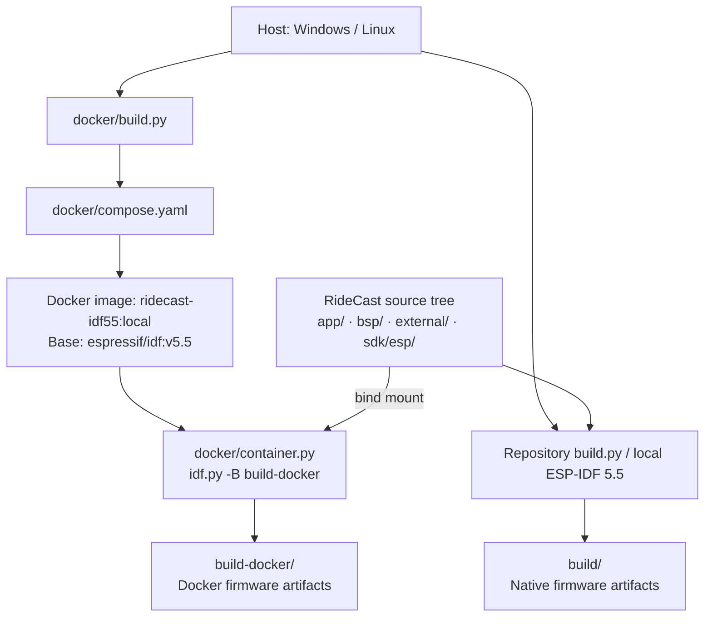
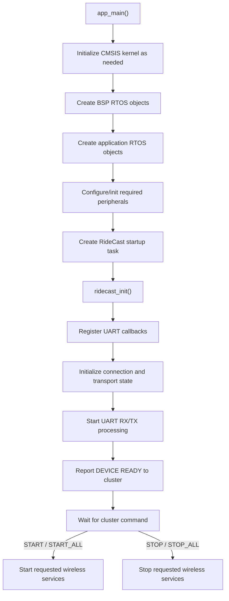
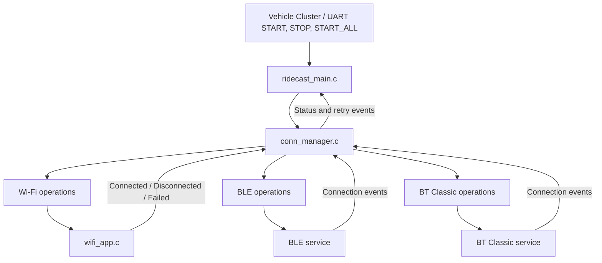

# RideCast

**Portable Communication Gateway for Vehicle Instrument Clusters**

**Project Status:** Phase 1 — Wi-Fi-to-UART Integration

**Initial Platform:** ESP32 / ESP-IDF 5.5

**Language:** C11

**Architecture:** Portable application + reusable BSP

**Development Method:** Gate-based, AI-assisted implementation

## 1. Project Overview

RideCast is an embedded communication gateway that connects a smartphone, PC, or other external device to a vehicle's instrument cluster MCU/MPU.

The goal is to enable vehicle clusters to receive and exchange information such as:

- Turn-by-turn navigation instructions
- Music playback information
- Incoming call information
- Phone notifications
- Vehicle and cluster status
- Application-specific commands and data

RideCast is **not a dashboard graphics renderer**. It is primarily responsible for communication, protocol handling, secure data exchange, and routing information to the cluster hardware.

The vehicle cluster remains responsible for interpreting its supported messages and presenting information to the rider.

### 1.1 Long-Term Vision

RideCast will support wireless connectivity through Wi-Fi and Bluetooth and communicate with vehicle hardware through UART, CAN, USB, or other supported interfaces.

Its application logic should be reusable across different MCU families wherever technically practical.

### 1.2 Immediate Objective

Phase 1 will validate the following path:

**Phone / PC → Wi-Fi → TCP → RideCast → UART → Cluster MCU / Test Receiver**

The initial communication is one-way and transfers raw binary bytes without an application-specific message protocol.

This is the first validation milestone, not the final RideCast feature set.

## 2. Architecture Principles

1. RideCast application modules must be independent of ESP-IDF driver APIs.
2. The reusable BSP provides portable public interfaces for hardware access.
3. Platform-specific implementations remain inside BSP platform ports.
4. Application networking uses BSD-compatible sockets directly.
5. No separate Network Abstraction Layer (NAL) will be introduced.
6. Application TLS and cryptography will use mbedTLS in a later phase.
7. CMSIS-RTOS2 is preferred for portable application task and synchronization interfaces, where supported by the existing port.
8. Existing BSP APIs must be reused rather than duplicated.
9. No dynamic architecture expansion is permitted during Phase 1.
10. Every implementation milestone must pass its validation gate before the next begins.

## 3. System Architecture

```text
+----------------------------------------------------+

|              APPLICATION CONFIGURATION             |

|----------------------------------------------------|

| Network | Wi-Fi | UART | Task | Buffer | Security   |

+----------------------------------------------------+

                         |

                         v

+----------------------------------------------------+

|                  RIDECAST APPLICATION              |

|----------------------------------------------------|

| Startup and Lifecycle                              |

| Wi-Fi Service Management                           |

| TCP Server                                         |

| Data Bridge                                        |

| Application State Management                       |

+----------------------------------------------------+

             |                          |

             v                          v

+------------------------+  +------------------------+

|    NETWORK SERVICES    |  |      REUSABLE BSP      |

|------------------------|  |------------------------|

| BSD Sockets            |  | Wi-Fi                  |

| lwIP                   |  | UART                   |

| mbedTLS (later phase)  |  | Logger                 |

|                        |  | CLI                    |

+------------------------+  +------------------------+

             |                          |

             +-------------+------------+

                           |

                           v

+----------------------------------------------------+

|                  PLATFORM LAYER                    |

|----------------------------------------------------|

| ESP-IDF / ESP32 Port                               |

| STM32 HAL / Other Ports (Future)                   |

+----------------------------------------------------+

                           |

                           v

+----------------------------------------------------+

|                       HARDWARE                     |

|----------------------------------------------------|

| Wi-Fi MCU | UART | Vehicle Cluster MCU / MPU       |

+----------------------------------------------------+
```

### 3.1 Application Layer

Contains RideCast-specific logic:

- Application initialization and shutdown
- Communication state management
- Wi-Fi service coordination
- TCP session management
- Data forwarding and routing
- Application-level validation and recovery

Portable application modules must not include ESP-IDF Wi-Fi or UART driver headers.

### 3.2 BSP Layer

The reusable BSP contains:

- Portable public interfaces
- Hardware-dependent driver implementations
- Logger
- CLI
- Hardware configuration
- Common return-status definitions

The BSP must not contain RideCast-specific names, protocols, or application state machines.

### 3.3 Network Stack

The initial application uses BSD socket APIs for TCP communication.

On ESP32, these sockets are provided through ESP-IDF's integrated lwIP implementation.

A separately maintained upstream lwIP source tree may exist under `external/`, but Phase 1 must not link a second lwIP implementation into the ESP32 firmware.

There is no NAL component.

### 3.4 Security

Application-level TLS and mbedTLS integration are outside Phase 1.

Phase 1 uses a local development Wi-Fi network and plaintext TCP only for controlled integration testing.

The prototype must not be deployed as a secure production communication system.

## 4. Repository Structure

This is the target organization for Phase 1. Existing BSP paths must be confirmed against the repository before changing any build files.

```text
ridecast/

|

+-- app/

|   +-- app_config/

|   |   +-- app_config.h

|   |   +-- app_wifi_config.h

|   |   +-- app_uart_config.h

|   |   +-- app_network_config.h

|   |

|   +-- include/

|   |   +-- ridecast_app.h

|   |   +-- ridecast_wifi_service.h

|   |   +-- ridecast_tcp_server.h

|   |   +-- ridecast_bridge.h

|   |

|   +-- main/

|   |   +-- app_main.c

|   |   +-- CMakeLists.txt

|   |

|   +-- src/

|       +-- ridecast_app.c

|       +-- ridecast_wifi_service.c

|       +-- ridecast_tcp_server.c

|       +-- ridecast_bridge.c

|

+-- bsp/

|   +-- bsp_config/

|   +-- include/

|   |   +-- bsp_core/

|   |   +-- bsp_uart.h

|   |   +-- bsp_wifi.h

|   |

|   +-- srcs/

|   |   +-- bsp_core/

|   |   |   +-- cli/

|   |   |   +-- logger/

|   |   |

|   |   +-- port/

|   |       +-- esp32x/

|   |       |   +-- bsp_uart.c

|   |       |   +-- bsp_wifi.c

|   |       +-- stm32h7x/

|   |

|   +-- bsp.cmake

|   +-- CMakeLists.txt

|

+-- external/

|   +-- component/

|   |   +-- lwip/

|   |   +-- mbedtls/

|   +-- os/

|       +-- cmsis/

|       +-- cmsis_esp/

|

+-- sdk/

|   +-- esp/

|

+-- tests/

|   +-- unit/

|   +-- integration/

|

+-- docs/

|   +-- images/

|   +-- doxygen/

|

+-- cmake/

+-- build.py

+-- CMakeLists.txt

+-- README.md

+-- PHASE_1_PLAN.md

+-- PHASE_1_EXECUTION_GUIDE.md
```

The application files listed above are planned integration modules. They must not be assumed to exist until verified.

## 5. Phase 1 Feature Definition

### 5.1 Wi-Fi

- Configure ESP32 in SoftAP mode.
- Start and stop Wi-Fi through the existing BSP Wi-Fi interface.
- Allow a phone or PC to connect to the development network.
- Report Wi-Fi service readiness accurately.

### 5.2 TCP Server

- Listen on a configurable TCP port.
- Accept one client at a time.
- Receive raw binary data.
- Handle disconnects and reconnects.
- Close resources safely on errors or shutdown.

### 5.3 UART

- Configure one dedicated UART for cluster communication.
- Use existing BSP UART interfaces.
- Forward received TCP bytes without modification.
- Handle partial writes, backpressure, and timeouts.
- Keep debugging output separate from the cluster UART.

### 5.4 Data Bridge

The initial bridge performs:

```text
TCP receive -> UART transmit
```

It must preserve byte order and byte values.

It must not introduce message interpretation, encryption, compression, routing rules, or framing in Phase 1.

### 5.5 Logging

Use the existing BSP logger.

The intended development default is `INFO`, provided this is supported by the current logger configuration.

Do not add runtime file logging registration or file enable/disable controls during Phase 1.

### 5.6 CLI

ESP-IDF provides the `esp_console` component, but RideCast will retain its reusable BSP CLI architecture.

New CLI features are not required for Phase 1.

The UART carrying cluster data must not be shared with an interactive command console.

## 6. Development Configuration

The following settings are proposed for the development prototype:

| Parameter | Initial value |
|---|---|
| Wi-Fi mode | SoftAP |
| Wi-Fi SSID | RideCast-Dev |
| Wi-Fi password | Configurable development credential |
| TCP protocol | IPv4 / TCP |
| TCP port | 3333 |
| Connected clients | 1 |
| UART speed | 115200 baud initially |
| UART format | 8N1 |
| TCP receive buffer | 256 bytes initially |
| Payload format | Raw binary |
| Application TLS | Disabled in Phase 1 |
| Log level | INFO |

UART peripheral selection, TX/RX pins, Wi-Fi capabilities, and board-specific restrictions must be verified for the actual hardware before implementation.

These values are configurable development defaults, not performance guarantees.

## 7. Phase 1 Success Criteria

Phase 1 is complete only when:

- [ ] Firmware builds using the existing project build system.
- [ ] BSP UART initializes and transmits correctly.
- [ ] BSP Wi-Fi starts in SoftAP mode.
- [ ] A phone or PC can establish a TCP connection.
- [ ] Binary data sent through TCP appears unchanged on the cluster UART.
- [ ] Repeated client connections work correctly.
- [ ] Invalid inputs and communication failures are handled without crashes.
- [ ] Resource cleanup and restart behavior are validated.
- [ ] Testing evidence is recorded.
- [ ] No prohibited architecture changes were introduced.

The exact tests and acceptance gates are defined in `PHASE_1_PLAN.md`.

## 8. Future Development

The following are explicitly outside Phase 1:

- Bidirectional UART/TCP communication
- Navigation message parsing
- Music and notification protocols
- BLE and Bluetooth Classic
- CAN and USB data routing
- TLS and AES-GCM
- OTA updates
- Remote CLI
- Production security provisioning
- Runtime file-specific logger configuration
- STM32 application integration

Future support must be added through separate, reviewed development phases.

## 9. Build and Documentation

RideCast supports two independent ESP-IDF 5.5 firmware build workflows:

- **Docker-based build (recommended for reproducible development):** build the ESP-IDF toolchain image once and then build the firmware inside the container. The host needs Python, Docker Desktop / Docker Engine, and Docker Compose, but does not need a native ESP-IDF toolchain.
- **Native build (outside Docker):** use the existing repository-root `build.py` with a locally configured ESP-IDF 5.5 environment. The existing native workflow is retained.

Both workflows use the **same RideCast source tree and `sdk/esp` ESP-IDF checkout**. They use separate output directories; Docker does not replace the native build.

### 9.1 Build architecture



**Build responsibilities and isolation:**

| Component | Responsibility |
|---|---|
| `docker/Dockerfile` | Defines the Docker toolchain image using `espressif/idf:v5.5`; firmware source is not baked into this image. |
| `docker/compose.yaml` | Defines the `ridecast` service and bind-mounts the repository at `/workspace/ridecast`. |
| `docker/build.py` | Runs Docker Compose and forwards firmware build, clean, size, flash, and monitor actions. |
| `docker/container.py` | Invokes `idf.py` from inside the container and selects the isolated `build-docker/` directory. |
| `sdk/esp` | Repository's ESP-IDF 5.5 checkout, used by the Docker runner as its `IDF_PATH`. |
| Root `build.py` | Existing local/native build interface, independent of Docker. |
| `build-docker/` | Firmware output generated by the container build; keep it out of version control. |
| `build/` | Firmware output generated by the existing native build workflow. |

### 9.2 Windows prerequisites for Docker builds

Install or enable:

1. **WSL 2** and the Windows virtualization features required by Docker Desktop.
2. **Docker Desktop**, configured to run Linux containers with its WSL 2 backend.
3. **Python 3.9 or newer** with `pip` for the host-side `docker/build.py` wrapper. Python 3.12 is a suitable development choice.
4. **Docker Compose v2**, normally included with Docker Desktop.
5. The ESP-IDF SDK submodule under `sdk/esp`, checked out at a compatible **5.5.x** version.

##### 1. How another developer can use RideCast
**Step 1 — Clone the repository**

```bash
git clone --recurse-submodules https://github.com/horsemann07/ridecast
cd ridecast
```
If the project has already been cloned:

```bash
git submodule update --init --recursive
```
This is important because your container.py expects ESP-IDF source files under sdk/esp.


**Step 2 — Download WSL, Docker and Python **

```powershell
cd ridecast
.\install_tool.bat
```

This install wsl, docker and python set the path and ask you to reboot system.

After reboot, open a **new PowerShell terminal**, then verify:

```powershell
wsl --status
docker --version
docker compose version
docker info
python --version
python -m pip --version
```

`docker --version` alone verifies only the CLI; `docker info` also checks that the Docker engine is running. Start Docker Desktop and complete its first-run setup before building. 
If PowerShell reports that `docker` is not recognized, correct the installation or `PATH` before invoking the build script.

Initialize the project's ESP-IDF checkout from the **RideCast repository root** when it is not already populated:

```powershell
git submodule update --init --recursive sdk/esp
```

The Docker runner checks that `sdk/esp/tools/cmake/project.cmake` exists and, when available, that the SDK version starts with `5.5`.

### 9.3 Build the Docker toolchain image

From the RideCast repository root:

```powershell
python docker/build.py --image-build
```

This runs the equivalent of:

```powershell
docker compose -f docker/compose.yaml build ridecast
```

It builds or refreshes the local image **`ridecast-idf55:local`** using `docker/Dockerfile`. **This step builds the Docker toolchain image, not the RideCast firmware.** Re-run it when the Dockerfile or toolchain-image requirements change; it is not required for every source edit.

### 9.4 Build RideCast firmware inside Docker

After the image has been built and Docker Desktop is running:

```powershell
python docker/build.py --build
```

The wrapper starts a temporary `ridecast` service container and invokes the ESP-IDF build through `docker/container.py`. The repository is mounted from the host, so source edits do **not** require rebuilding the image.

The generated firmware and related ESP-IDF files are written to **`build-docker/`** at the repository root, not to the native `build/` directory.

Other supported Docker firmware operations:

```powershell
# Reconfigure/rebuild firmware from a clean Docker build directory
python docker/build.py --fullclean --build

# Clean the Docker build output
python docker/build.py --clean

# Display firmware size using the Docker toolchain
python docker/build.py --size

# Configure firmware options (interactive terminal required)
python docker/build.py --menuconfig
```

**Build failures:** An ESP-IDF compiler, CMake, or linker error inside Docker is still a firmware/project error and is not necessarily caused by Docker. If the `docker` command is missing, Docker Desktop is not running, or the `sdk/esp` submodule is absent, fix that prerequisite first.

### 9.5 Build RideCast firmware natively (outside Docker)

The project retains its existing repository-root `build.py` workflow. On Windows, use an ESP-IDF 5.5-configured terminal with the required native Python, CMake, Ninja, and Espressif cross-compilation tools available:

```powershell
# Show the options supported by the checked-in native script
python.exe .\build.py -h

# Build RideCast firmware using the existing native workflow
python.exe .\build.py -b
```

The native build uses the normal **`build/`** directory. It does not require a Docker image or Docker Desktop. Build flags and target selection must be verified from the checked-in repository-root script before use.

If the local ESP-IDF environment has been activated, the standard ESP-IDF command is also available as an alternative where supported by the project configuration:

```powershell
idf.py build
```

Do not reuse CMake cache or generated output files between `build/` and `build-docker/`.

### 9.6 Firmware flashing and serial monitor (optional)

The Docker build and the native build produce firmware; **neither build command flashes hardware automatically**.

On Windows, the Docker wrapper's flash path uses **host Python** and the generated `build-docker/flasher_args.json` metadata, because Linux containers generally cannot directly use Windows `COM` ports:

```powershell
# Install host-side flashing dependencies first
python -m pip install -r docker/requirements-host-flash.txt

# After a successful Docker firmware build; replace COM7 as needed
python docker/build.py --flash --port COM7
python docker/build.py --monitor --port COM7
```

On Linux, a serial device can be passed into the container (ensure host device permissions are configured):

```bash
python3 docker/build.py --flash --port /dev/ttyUSB0
python3 docker/build.py --monitor --port /dev/ttyUSB0
```

For the native ESP-IDF toolchain, follow the checked-in root build script's supported flash/monitor options or the standard `idf.py` workflow for the selected board.

### 9.7 Documentation conventions

- Portable interfaces use concise Doxygen.
- Private functions are documented at their prototypes.
- Function separators use `/*------------------------------------------*/`.
- Code formatting must be readable and consistent.
- Change logs, when updated, list the newest entry first.
- Tests and hardware validation must never be claimed without evidence.

**Build verification status:** These commands document the intended workflow; they do not claim that a Docker image build, a complete RideCast firmware build, or hardware flashing has succeeded on the user's machine.

## 10. Development Governance

All AI-assisted development must follow:

1. `README.md`
2. `PHASE_1_PLAN.md`
3. `PHASE_1_EXECUTION_GUIDE.md`

The plan and execution guide take precedence for Phase 1 implementation details.

Do not move to another milestone when the current milestone has unresolved failures.

Do not expand implementation scope without an explicit plan revision.

## 11. Status

**Phase 1:** Not yet validated.

**First required activity:** Audit the current repository, BSP API signatures, ESP32 board configuration, and baseline build.

No application integration or hardware validation is claimed by this document.

```text
        VEHICLE CLUSTER             RIDECAST                  MOBILE APP

              |                        |                          |

              |                  Power ON                        |

              |                        |                          |

              |                 Initialize UART                  |

              |                 Wi-Fi OFF                        |

              |                 BLE OFF                          |

              |                        |                          |

              |<----- DEVICE_READY ----|                          |

              |                        |                          |

              |------ START ---------->|                          |

              |                        |                          |

              |                 Start Wi-Fi AP                    |

              |                 Start BLE (future)                |

              |                        |                          |

              |                 Create pairing session           |

              |                 Generate 6-digit code            |

              |                        |                          |

              |<---- PAIRING_INFO -----|                          |

              |                        |                          |

       Display pairing code            |                          |

              |                        |---- Advertise/Listen --->|

              |                        |                          |

              |                        |<---- Connect request ----|

              |<--- APP_CONNECTING ----|                          |

              |                        |                          |

              |                        |<--- Pairing proof -------|

              |                        |                          |

              |                 Verify pairing/session           |

              |                        |                          |

              |                        |---- Auth success ------->|

              |<---- APP_CONNECTED ----|                          |

              |      Device name       |                          |

              |      Transport         |                          |

              |                        |                          |

       Display "Connected"             |                          |

              |                        |                          |

              |                        |<--- Notification --------|

              |<--- NOTIFICATION ------|                          |

              |                        |                          |

              |                        |<--- Music metadata ------|

              |<--- MEDIA_INFO --------|                          |

              |                        |                          |

              |                        |<--- Navigation ----------|

              |<--- NAVIGATION --------|                          |

              |                        |                          |

              |                        |                          |

              |                        |<--- Connection lost -----|

              |<--- DISCONNECTED ------|                          |

              |                        |                          |

       Show "Disconnected"             |                          |

              |                        |                          |

              |                 Reconnect window 1               |

              |<----- RETRY(1/5) -----|                          |

              |                        |                          |

              |                       ...                         |

              |                        |                          |

              |                 Reconnect window 5               |

              |<----- RETRY(5/5) -----|                          |

              |                        |                          |

              |                 No successful reconnection       |

              |                        |                          |

              |<--- CONNECTION_FAILED -|                          |

              |                        |                          |

        Show failure                   |                          |

              |                        |                          |

              |                 Wait for cluster command         |

              |                        |                          |

              |------ RESTART -------->|                          |

              |                        |                          |

              |                 Restart pairing/connection       |
```

## APP_MAIN



## CONNECTION MANAGER


